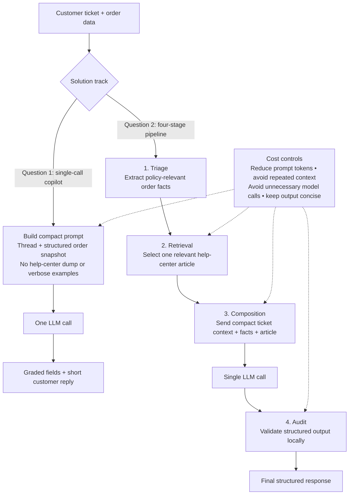

# ShopAssist LLM Cost Optimization — Submission Notes

## Question 1: Single-call copilot
- Removed the full help-center dump and verbose few-shot reasoning from every request.
- Removed nondeterministic run IDs and compacted the order JSON.
- Kept the customer thread and structured order snapshot so the model has the ticket context.
- Returns only the graded fields plus a short customer reply.

## Question 2: Four-stage pipeline
- Kept triage, retrieval, composition, and audit as distinct stages.
- Triage extracts only policy-relevant order facts.
- Retrieval narrows the expanded help center to a single relevant candidate article rather than sending the 200k+ token corpus.
- Composition is the only model call. Audit validates the structured response locally.
- This avoids paying for repeated full-context prompts and unnecessary LLM calls at triage, retrieval, and audit.

## Validation
- `pytest -q` checks all four public tickets, the Q1 holdout ticket, the large-help-center fixture, and the per-ticket cost ceilings.
- GitHub Actions runs the tests on pushes and pull requests.
- The `llm-cost-report` Actions artifact contains exact per-call input/output token counts and points for each public ticket in both tracks.
- Cost formula: `uncached_input × 3 + cached_input × 0.3 + output × 15`.

## Targets
- Q1: at most 3,000 points per public ticket.
- Q2: at most 2,500 points per public ticket.

## Solution flow diagram

The assignment implements two cost-optimized ways to answer a ShopAssist support ticket. Q1 uses one compact model request. Q2 reduces the context in stages and reserves the model call for response composition.

### How to read the diagram

- **Question 1:** The ticket thread and compact order snapshot go directly into one LLM call. The large help-center corpus, verbose few-shot reasoning, and nondeterministic run IDs are excluded.
- **Question 2:** Triage extracts only relevant facts; retrieval narrows the help center to one candidate article; composition makes the only LLM call; and audit checks the result locally.
- **Why it saves cost:** Large, repeated context is removed before inference, and deterministic stages do not spend tokens on additional model calls. The cost report measures input/output usage using the scoring formula listed below.

