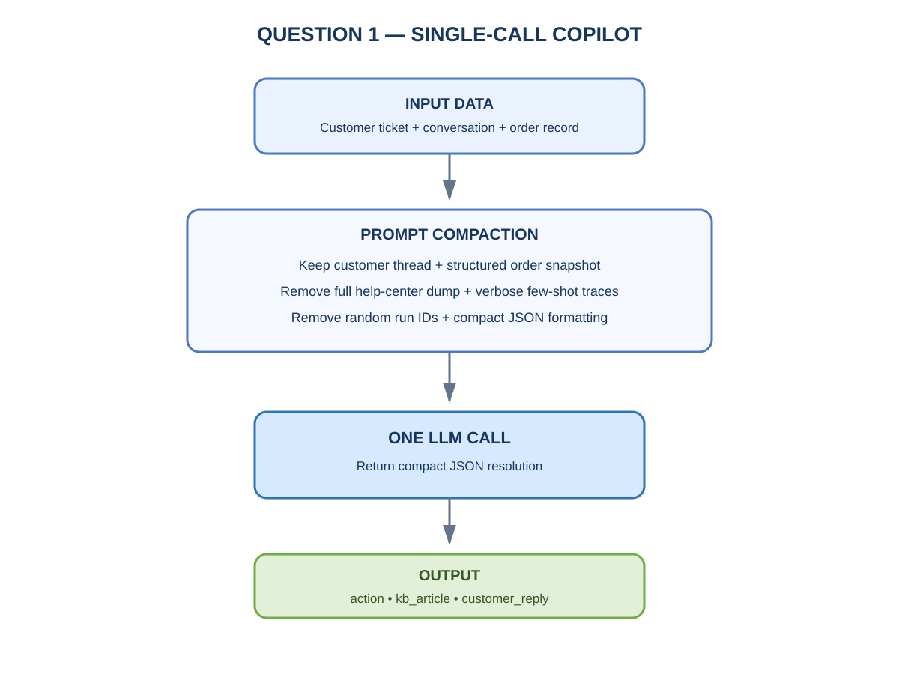
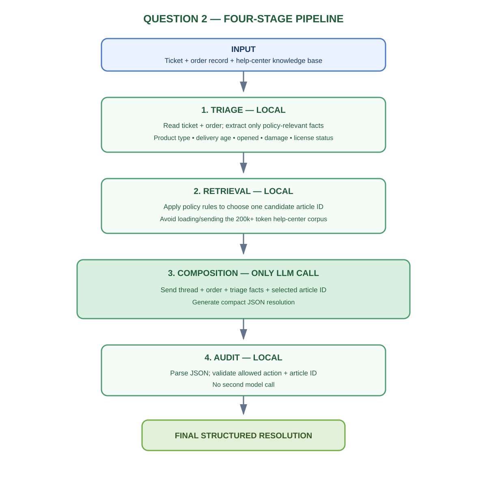

# ShopAssist LLM Cost Optimization — Submission Notes

## Question 1: Single-call copilot
- Removed the full help-center dump and verbose few-shot reasoning from every request.
- Removed nondeterministic run IDs and compacted the order JSON.
- Kept the customer thread and structured order snapshot so the model has the ticket context.
- Returns only the graded fields plus a short customer reply.

## Question 2: Four-stage pipeline
- Kept triage, retrieval, composition, and audit as distinct stages.
- Triage extracts only policy-relevant order facts.
- Retrieval narrows the expanded help center to a single relevant candidate article rather than sending the 200k+ token corpus.
- Composition is the only model call. Audit validates the structured response locally.
- This avoids paying for repeated full-context prompts and unnecessary LLM calls at triage, retrieval, and audit.

## Validation
- `pytest -q` checks all four public tickets, the Q1 holdout ticket, the large-help-center fixture, and the per-ticket cost ceilings.
- GitHub Actions runs the tests on pushes and pull requests.
- The `llm-cost-report` Actions artifact contains exact per-call input/output token counts and points for each public ticket in both tracks.
- Cost formula: `uncached_input × 3 + cached_input × 0.3 + output × 15`.

## Targets
- Q1: at most 3,000 points per public ticket.
- Q2: at most 2,500 points per public ticket.

## Solution diagrams

The two questions use different solution designs, so each is shown separately below. Both diagrams are available as editable draw.io files.

### Question 1 — Single-call copilot

The copilot builds a compact prompt from the customer conversation and structured order snapshot, then makes one LLM request. It removes the full help-center dump, verbose few-shot traces, and nondeterministic run IDs.

[Open editable Question 1 diagram in draw.io](diagrams/question1-single-call.drawio)

### Question 2 — Four-stage pipeline

The pipeline performs triage and article retrieval locally, makes one LLM call for composition, and validates the generated JSON locally during audit. Only one candidate article ID is passed instead of the full help-center corpus.

[Open editable Question 2 diagram in draw.io](diagrams/question2-four-stage.drawio)

### Shared cost objective

Both designs reduce unnecessary prompt tokens. Question 1 uses a compact single request; Question 2 adds deterministic preprocessing and local validation so only composition requires model inference.
